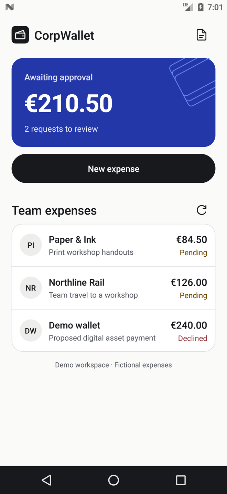

# CorpWallet · Team expense desk

Review a team’s sample expenses on Android. The desk shows the euro amount awaiting approval and lists each request with its supplier, amount and status. Open a request to see its purpose and record a decision. Submit a fictional request with **Crypto wallet** as the destination and the server declines it immediately, even if someone later tries to approve it. All amounts are in euros.



## Try an expense

1. Open the app. **Paper & Ink** and **Northline Rail** are sample supplier invoices.
2. Open an invoice and choose **Approve** or **Decline**. The desk reloads its decisions from the server.
3. Open **Demo wallet** to read why the expense was automatically declined. **New expense** lets you try the same policy with your own fictional example.
4. Use **Export build report** (the document icon beside CorpWallet) to save a JSON with two build settings. Open it in the [companion evidence reader](https://corpwallet-build-evidence.vercel.app/) for a plain-language explanation.

This is a local learning workspace. It uses invented data, a single reviewer and one in-memory API process. Restarting the API restores the sample expenses. Do not enter financial or personal information. It does not process payments.

## Start the API

Use Python 3.10+ in the `backend` directory:

```sh
python3 -m venv .venv
source .venv/bin/activate
pip install -r requirements.txt
python -m unittest discover -s tests
python -m uvicorn app.main:app --host 127.0.0.1 --port 8000
```

Open http://127.0.0.1:8000/docs to try the API. Both `app.main:app` and the older `main:app` entry point serve the same endpoints.

## Run Android

Install Android Studio with JDK 17, Android SDK 34 and an API 24+ emulator or a USB-connected Android device. Start the emulator or authorise USB debugging on your own device, then:

```sh
adb reverse tcp:8000 tcp:8000
cd android-app
./gradlew :app:installDebug
adb shell am start -n com.corpwallet.mobilepoc/.PendingTransactionsActivity
```

With multiple devices use `adb -s DEVICE` and select the device in Android Studio. The debug build contacts loopback through the USB/emulator bridge. A release build uses an HTTPS API origin supplied with `-PwalletApiUrl=https://your-api.example`. Without that property the release can export evidence but will explain that it needs an API address to review expenses. Keep this sample API on your machine unless you implement real authentication, authorisation and durable storage.

## What to inspect in the code

| Question | Starting point |
| --- | --- |
| Why did a wallet request never enter the queue? | [Server policy and decision locking](backend/app/services/transaction_service.py) |
| Can an earlier decision be overwritten? | [Policy tests](backend/tests/test_expenses.py) |
| What did Android actually send? | [Expense API client](android-app/app/src/main/java/com/corpwallet/mobilepoc/ExpenseApi.kt) |
| What goes in a build report? | [Android export and review desk](android-app/app/src/main/java/com/corpwallet/mobilepoc/PendingTransactionsActivity.kt) |
| How is release hardening enabled? | [Gradle build types](android-app/app/build.gradle.kts) and [verification steps](docs/configuration-review-checklist.md) |

See [architecture](docs/architecture.md), [scope](docs/poc-scope.md) and [troubleshooting](docs/troubleshooting.md).
